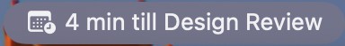

# Meeting Countdown

**Never be the person who joins five minutes late.**

Meeting Countdown is a small Mac menu bar app that watches your calendar and puts a live countdown on screen in the ten minutes before your next meeting. When there's 1 min remaining, the countdown moves to the center of the screen so you really can't miss it. Click "join" to join a video chat link if there is one.

It works with the calendars your Mac already has (iCloud, Google, Exchange / Microsoft 365, CalDAV), so there's nothing to sign in to or set up, just grant calendar access.

<p align="center">
  <br><br>
  
  &nbsp;&nbsp;
  
</p>

## Features

**A countdown you can't miss**
- A small floating card appears 10 minutes before each meeting and counts down to the second.
- In the final minute it glides to the middle of your screen, so you notice it even mid-task.
- It stays on top of other windows. Drag it anywhere you like.
- It disappears when the meeting starts, and stays out of the way once you've joined.

**One-click Join**
- Finds the video call link in the invite, wherever the organizer put it: location, notes, or URL.
- Knows Zoom, Google Meet, Microsoft Teams, Webex, Whereby, Amazon Chime, GoTo Meeting, Slack huddles, and Jitsi Meet.
- Ignores links that aren't the call itself, like dial-in pages and help articles.
- Opens the Zoom or Teams desktop app directly when you have it installed, skipping the "Open in app?" browser page.
- Uses your Google Meet web app installed from Chrome if you have one, and reuses a Meet window that's already open instead of piling up new ones. It never takes over a window you're already in a call in.
- Can open calls from each calendar account in a particular Chrome profile, so work calls open signed in to your work account.
- Press ⌘J in the menu to join the next meeting.

**Your day at a glance in the menu bar**
- The menu bar shows what's next and how soon: "4 min till Design Review".
- The menu lists meetings that started in the last 30 minutes, the next meeting, and everything else in the next 90 minutes, each with its own Join button and color-coded by calendar.
- Click a meeting to open it in Calendar.

**Only meetings that matter**
- Skips all-day events, events you've declined, and cancelled events.
- Choose which calendars to watch in Settings. Turn off the family calendar or the team holiday calendar.
- Notices new, moved, and cancelled events right away, with no restart.

**Lightweight and private**
- Lives in the menu bar, with no Dock icon.
- Reads your calendar through macOS itself. Nothing leaves your Mac and there's no account to create.

## Requirements

macOS 14 (Sonoma) or later.

## Building from source

You'll need Xcode with Swift 6.

```sh
scripts/build-app.sh          # builds build/MeetingCountdown.app (release)
open build/MeetingCountdown.app
```

On first launch macOS asks for calendar access. If you deny it, the menu offers a shortcut to the Calendars privacy pane.

While developing, `scripts/dev.sh` builds (debug by default; pass `release` for a release build), quits any running instance, and launches the new build. Arguments after the build type are passed to the app.

The bundle is signed with an Apple Development certificate (`SIGN_IDENTITY` in `scripts/build-app.sh`; set `SIGN_IDENTITY=-` to sign ad-hoc), so permissions carry over between rebuilds. To reset the calendar permission, run `tccutil reset Calendar com.rtortora.MeetingCountdown`.

Run the tests with `swift test`.

### Demo mode and screenshots

`scripts/dev.sh debug --demo` replaces your calendars with a made-up day (`DemoCalendar`), timed from launch: a standup that started 8 minutes ago, a Google Meet design review about 4½ minutes away (so the overlay is already counting down), and more meetings later. It also includes an all-day, a declined, and a cancelled event, which shouldn't appear. Add `--show-menu` to open the menu automatically.

The images above come from `scripts/dev.sh debug --demo --show-menu`, captured window by window with `screencapture -l <window id>` so the rest of the desktop stays out of the shot. The menu is the exception: its translucent background turns flat gray when captured on its own. So it's captured as a screen region (`screencapture -R`), with a plain white window placed above the menu bar and below the menu.

### Layout

- `Sources/MeetingCountdownCore` contains the pure logic: picking the next meeting, the countdown/overlay-window math, finding video call links in invites (`VideoLink`), and the demo schedule. It has no EventKit dependency and is unit tested.
- `Sources/MeetingCountdown` is the app: the EventKit wrapper (`CalendarService`), the floating panel (`OverlayController`), the menu bar item plus tick loop (`AppController`), and opening a call in a native app, a browser-installed web app, or the browser (`VideoLinkOpener`).
- `Resources/Info.plist` sets `LSUIElement` (so there is no Dock icon), the calendar usage strings, and the Apple Events usage string (Join scripts the browser to reuse an open web app window).
- `Resources/AppIcon.png` is the app icon; `scripts/build-app.sh` turns it into `AppIcon.icns`.

See [intent.md](intent.md) for the product plan.
