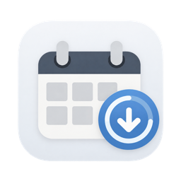
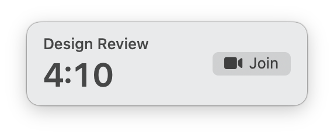
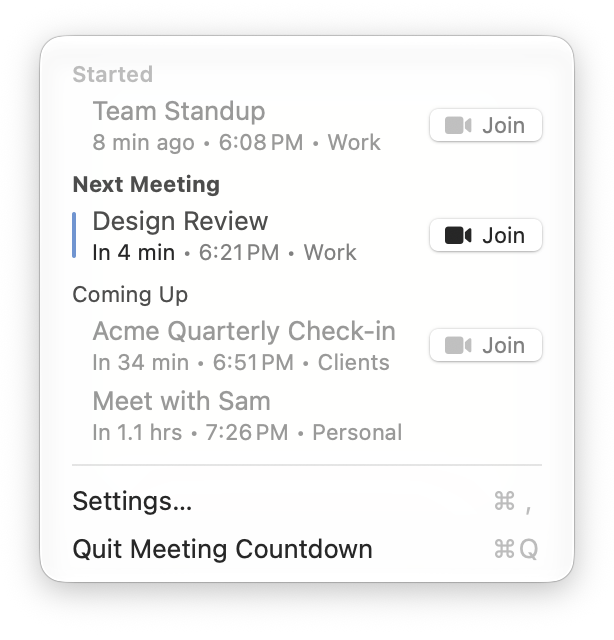

  

<h1 align="center">Meeting Countdown</h1>

Don't miss a meeting!

Meeting Countdown is a small free Mac menu bar app that watches your calendar and puts a live countdown on screen in the ten minutes before your next meeting.

When there's 1 min remaining, the countdown moves to the center of the screen so you really can't miss it.

Click "join" to join a video chat link if there is one.

## Features

* It works with the calendars your Mac already has, so there's nothing to sign in to or set up, just grant calendar access.
* You can configure video chat link preferences per-calendar and have it prefer a specific Chrome profile or the Google Meet app.
* The Menu Bar provides a snapshot into your meetings from 30 mins ago to 1.5 hrs into the future. 

## Requirements

macOS 14 (Sonoma) or later.

## AI Disclosure

Meeting Countdown was designed by me, a human, but entirely vibe-coded with Claude. The app icon was generated with ChatGPT.
